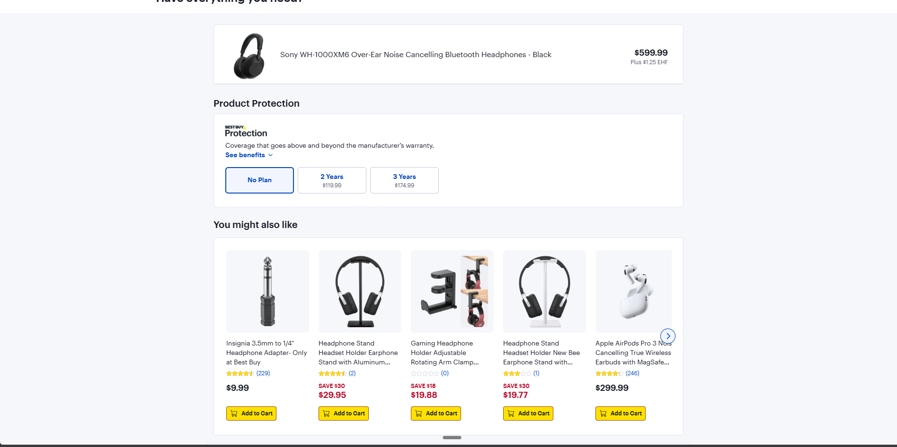
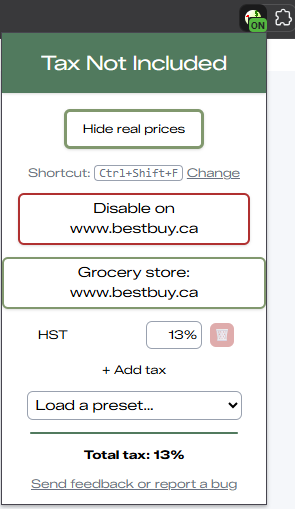
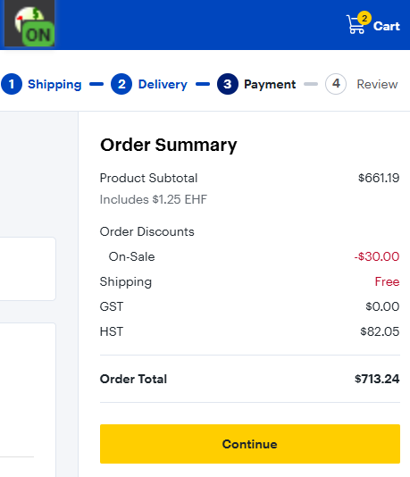

# tax-not-included
Tax Not Included is a chromium-based extension that automatically replaces instances of prices with post-tax calculation.

## Install
1. Download or clone this repository.
2. Open `chrome://extensions` (or `edge://extensions`, `brave://extensions`) and turn on **Developer mode**.
3. Click **Load unpacked** and pick the repository folder.

## Using it
- Prices on every site are shown with tax included. Hover a price to see what it was before tax.
- Click the toolbar icon to set your tax rates as percentages, or pick a preset for your province or state. Stacked taxes add up, so GST 5% + PST 7% is 12%.
- Press **Ctrl+Shift+F** (or the button in the popup) to switch between real and original prices. The badge shows ON or OFF.
- Turn the extension off for a single site, or mark a site as a grocery store to give it its own rate (0% by default).

## Gallery

| | |
|:-:|:-:|
|  Product page with the site's original prices |  The same page with tax included |
|  Popup for editing tax rates, turning the extension off for a site, or marking it as a grocery store |  Checkout totals that already include tax are left alone |

## Challenges

### The observer feedback loop
A lot of prices don't exist when the page first loads. SPAs, lazy loading, upsells, and cart popups all add or swap prices in later, so I used a `MutationObserver` to catch them. The catch is that changing a price is also a DOM change, so the observer would pick up my own edits and add tax on top of tax. I ended up disconnecting the observer while applying rates and reconnecting it after, and batching mutations with a 500ms debounce so a burst of changes only gets processed once. Every reset path also has to reconnect the observer, which I learned the hard way when prices on some pages quietly stopped updating.

### Making it stick on every site
Every store builds its pages differently, so most of my time went into debugging site after site:
- Split prices like `$12.99` are everywhere. My first fix calculated them twice, until I switched to tracking processed text nodes instead of their parent elements.
- Turning the extension off used to restore each element's `innerHTML`. That re-injected stale markup and broke anything the site had already replaced (switching a product's colour, for example), so now I restore each text node and skip ones that are no longer on the page.
- Some sites update their own prices in place, which made my saved "original" values stale. I now detect those changes and recalculate from the new price.
- In SPAs the URL changes without a page load, so I watch for that and start fresh.

### Parsing prices in every format
Prices show up as `$1,000.50`, `1.000,50 €`, `1 000,50`, and plenty more. At one point I was reading a thousands-separator dot as a decimal point, so prices came out 1000x too small (I would not have minded that at checkout). Now the parser figures out which separator is the decimal and falls back to a period when it can't tell.

### Knowing when to leave a page alone
Changing the wrong number is worse than changing nothing. Pages without prices are never touched, and checkout totals that already include tax are skipped so you don't pay tax twice on paper. I have a test suite just for checking that these pages come through unmodified.

### Testing an extension outside the browser
My tests run in Node with jsdom, with a shared stub for the `chrome.*` APIs and a shared page loader. Whenever a real site broke something (split prices, separator formats, checkout pages), I turned it into a test page so it stays fixed.

### Settings that survive
Rates sync across devices with `chrome.storage.sync`, and the on/off state lives in `chrome.storage.local`. The service worker restores the badge on startup, and the on/off choice now survives extension updates. Smaller things needed care too: applying a default rate before anything is saved, and keeping a rate's old name if you clear the name field instead of saving a blank one.

## Limitations
- Recognised currencies are `$`, `€`, `£`, `USD`, `EUR` and `CAD`. More can be added to `currencyCodes` and `currencySymbols` in [scripts/utils.js](scripts/utils.js).
- Checkout totals that already include tax are found by their wording, which is only recognised in English and French.
- US presets are state rates only, since county and city taxes vary.

## Development
- `npm test` runs the jsdom test suites.
- The popup's styles are precompiled. After changing Tailwind classes in `popup/popup.html` or `popup/popup.js`, run `npm run build:css` and commit the updated `popup/popup.css`.
